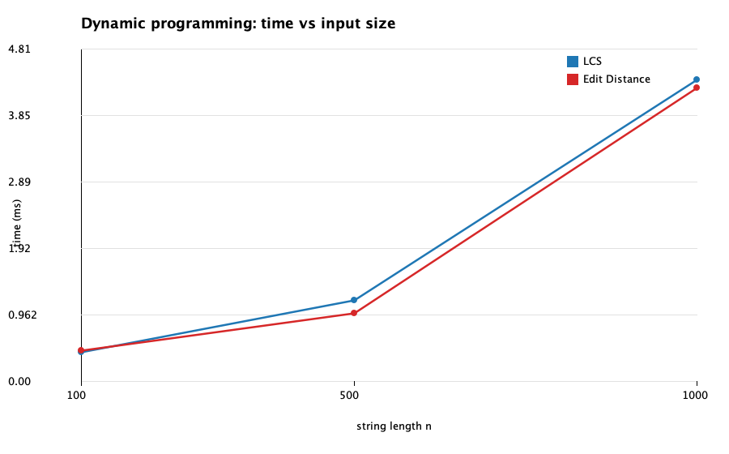
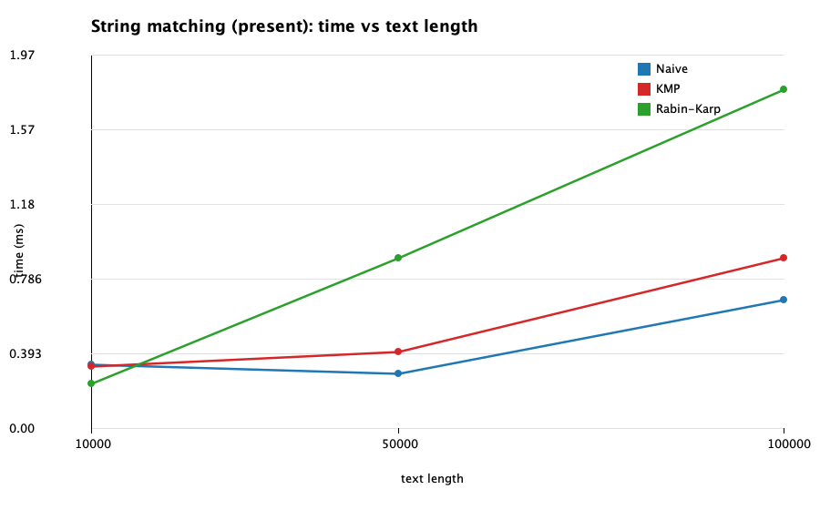
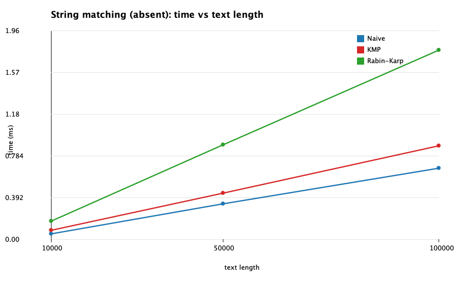
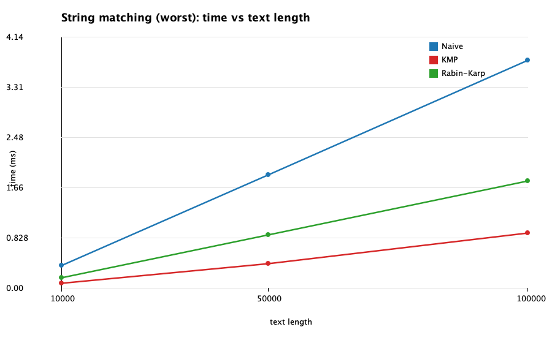
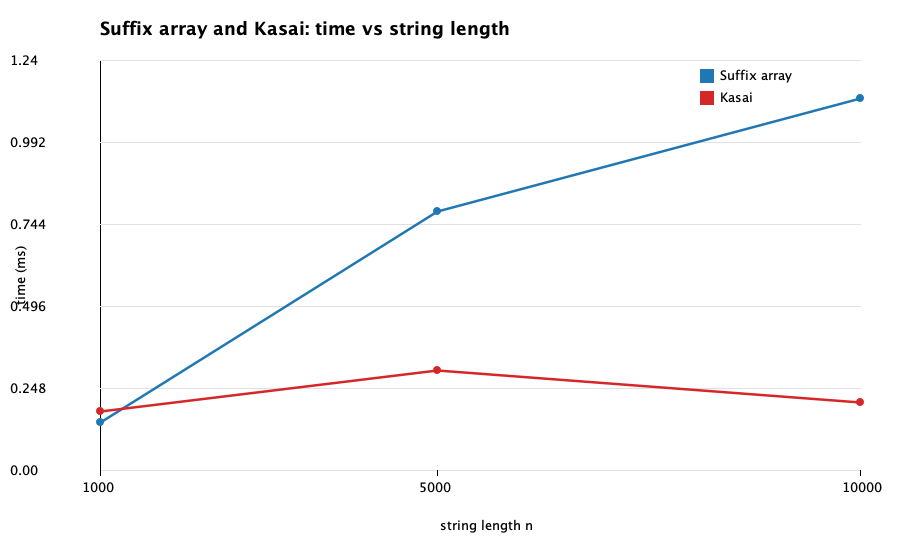

# Assignment 4: Text Analysis, Dynamic Programming and String Algorithms

**Author:** Mumina Mukazhan, **Group:** SE-2530
**Repository:** https://github.com/muminamukazhan/daa4assignment

## 1. Problem description and algorithm overview

| Part | Algorithm | Task |
|---|---|---|
| A | LCS | Length of the longest common subsequence of two strings |
| A | Edit Distance | Minimum number of insertions, deletions and substitutions to turn one string into another |
| B | Naive matching | Baseline: compare the pattern at every shift |
| B | KMP | Preprocess the pattern into an LPS table so the text pointer never moves back |
| B | Rabin-Karp | Compare a rolling hash of the text window with the pattern hash, verify on a hit |
| C | Kasai | Build the LCP array from a string and its suffix array in linear time |
| C (helper) | Suffix array by prefix doubling | Produces the suffix array that Kasai takes as input |

All algorithms are implemented from scratch. The standard library is used for supporting tasks such as collections, random data generation, timing, file handling and plotting.

```
src/main/java/textanalysis/   Lcs, EditDistance, PatternMatcher, NaiveMatcher, KmpMatcher,
                              RabinKarpMatcher, SuffixArrays, Kasai, Benchmark, Plot
src/test/java/textanalysis/   TestRunner
results/                      results.md and the PNG plots
```

## 2. Implementation decisions and assumptions

- **Data:** alphabet `ACGT`, fixed seed 42. A text or first string of length `n` uses seed `42 + n`; the second string uses `42 + n + 1`.
- **Empty pattern:** matches at every position `0..n` (n + 1 occurrences) in all three matchers. A pattern longer than the text gives an empty result. Overlapping occurrences are reported (`aaaa`, `aa` gives `0, 1, 2`).
- **DP:** the full `(n+1) x (m+1)` table is stored, so the recurrence and base cases are visible in the code.
- **Rabin-Karp:** base 131, modulus 1 000 000 007. Every hash hit is verified character by character; failed verifications are counted as collisions.
- **Operation counts:** character comparisons for Naive and KMP (KMP includes LPS construction). For Rabin-Karp only verification comparisons are counted, since hash updates are arithmetic. For DP, table cells.
- **Suffix array:** prefix doubling with counting sort on pairs `(rank[i], rank[i+k])`. It is built outside the timed region of the Kasai measurement and timed separately.
- **LCP convention:** `lcp[0] = 0`; `lcp[i]` is the LCP of suffixes `sa[i-1]` and `sa[i]`.

## 3. Complexity analysis

`n` = text length (or first string), `m` = pattern length (or second string), `σ` = largest character code + 1.

| Algorithm | Main operation / recurrence | Best case | Worst case | Auxiliary space | Justification |
|---|---|---|---|---|---|
| LCS | `dp[i][j] = dp[i-1][j-1] + 1` if `a[i] == b[j]`, else `max(dp[i-1][j], dp[i][j-1])`; `dp[0][*] = dp[*][0] = 0` | Θ(nm) | Θ(nm) | Θ(nm) | Each cell is computed once in O(1); the whole table is stored. The content of the strings does not matter. |
| Edit Distance | `dp[i][j] = min(dp[i-1][j] + 1, dp[i][j-1] + 1, dp[i-1][j-1] + [a[i] != b[j]])`; `dp[i][0] = i`, `dp[0][j] = j` | Θ(nm) | Θ(nm) | Θ(nm) | Same as LCS. |
| Naive | compare the pattern at every shift | Θ(n - m + 1) for n ≥ m (mismatch on the first character at every shift) | Θ(nm) (`A...A` against `A...AC`) | O(1) | n - m + 1 shifts, up to m comparisons each. On random text over 4 letters about 4/3 comparisons per shift. |
| KMP | LPS table; on mismatch `j = lps[j-1]` | Θ(n + m) | Θ(n + m) | Θ(m) | LPS is built in O(m). In the search the text index only grows and `j` can drop only as often as it has grown, so the search is O(n) for any input. |
| Rabin-Karp | `h' = ((h - t[i]·B^(m-1))·B + t[i+m]) mod p` | Θ(n + m) | Θ(nm) | O(1) | Hash update is O(1); verification (O(m)) only on a hash hit. Expected linear time assumes that hash collisions are rare. The worst-case time is quadratic when many windows require character-by-character verification, e.g. pattern `A...A` in text `A...A`. |
| Suffix array (doubling, helper) | sort by pair `(rank[i], rank[i+k])`, `k = 1, 2, 4, ...` | Θ(n) per round; fewer rounds if ranks become distinct early | Θ(n log n) | Θ(n + σ) | Each round is O(n). After round k suffixes are ordered by their first 2k characters, so at most ⌈log₂ n⌉ rounds. `aaaa...` needs all of them. |
| Kasai | `h` is carried to the next suffix and drops by at most 1 per step | Θ(n) | Θ(n) | Θ(n) | `h` grows only in the inner loop, drops at most 1 per outer step and never exceeds n, so the inner loop runs at most 2n times in total. |

Auxiliary space excludes the memory required to store the returned match positions.

**Theory vs measurement.** The table counts abstract operations. Measured time (section 6) also depends on the JVM, caches, allocation and the cost of individual instructions, for example a modulo is slower than a character comparison. Only operation counts can be compared directly with Big-O. Rabin-Karp is linear in expectation but quadratic in the worst case; Naive is linear on random text but quadratic on adversarial text; the other algorithms have the same bound for every input.

**Why the recurrences are correct.**
- *LCS.* If the last characters are equal, some optimal subsequence can end with them, so the answer is 1 plus the LCS of the shorter prefixes. If they differ, at least one of them is unused, so we take the better of dropping the last character of `a` or of `b`. With an empty prefix the answer is 0.
- *Edit Distance.* The last step of an optimal alignment of `a[1..i]` and `b[1..j]` is a deletion, an insertion, or aligning `a[i]` with `b[j]` (cost 0 if equal, 1 otherwise). Taking the minimum of these three over optimal subproblems gives the optimum. Converting to or from an empty string costs the other string's length.

**How KMP avoids repeated comparisons.** `lps[k]` is the length of the longest proper prefix of `pattern[0..k]` that is also its suffix. After a mismatch at position `j`, the last `lps[j-1]` text characters already equal the pattern prefix, so matching continues from `j = lps[j-1]` without re-reading them.

**How Rabin-Karp handles collisions.** Equal hashes do not guarantee equal strings, so each hash hit is checked character by character and only verified windows are reported. Expected linear time assumes that hash collisions are rare; the worst-case time is quadratic when many windows require character-by-character verification. No collisions occurred in our runs (verification comparisons equal `m` per occurrence).

**What the LCP array represents.** `lcp[i]` is the longest common prefix of the two neighbouring suffixes `sa[i-1]` and `sa[i]` in sorted order. It is used for finding repeated substrings (the maximum is the longest repeated substring), counting distinct substrings and speeding up search in a suffix array. Kasai relies on `lcp(rank[i+1]) >= lcp(rank[i]) - 1`, so `h` never restarts from 0.

## 4. Testing strategy and results

Run `java -cp out textanalysis.TestRunner`. Result: `passed=1080 failed=0`.

| Algorithm | Cases |
|---|---|
| LCS | identical strings, completely different strings, empty left / right / both, classic examples (`ABCBDAB` / `BDCABA` = 4) |
| Edit Distance | identical, one empty (both directions), substitution (`cat`/`cut`), insertion (`cat`/`cart`), deletion (`cart`/`cat`), `kitten`/`sitting` = 3, symmetry |
| String matching | pattern at the beginning, middle and end; multiple and overlapping occurrences; absent pattern; pattern longer than text; empty pattern; empty text. For every case Naive, KMP and Rabin-Karp are compared with the expected list and with each other. Also 300 random binary cases and the LPS table of `ababaca` (`0,0,1,2,3,0,1`). |
| Suffix array | empty, single character, `banana`, `aaaaa`, `mississippi`, 300 random strings against a reference sort, periodic string `ab` x 500 |
| Kasai | `banana` with a manually verified suffix array, empty string, single character, 100 random strings against a brute-force LCP |

**Manual Kasai example.** For `banana`:

| i | sa[i] | suffix | lcp[i] |
|---|---|---|---|
| 0 | 5 | `a` | 0 |
| 1 | 3 | `ana` | 1 |
| 2 | 1 | `anana` | 3 |
| 3 | 0 | `banana` | 0 |
| 4 | 4 | `na` | 0 |
| 5 | 2 | `nana` | 2 |

So `sa = [5, 3, 1, 0, 4, 2]` and `lcp = [0, 1, 3, 0, 0, 2]`. For example `ana` and `anana` share `ana` (3), and `na` and `nana` share `na` (2).

## 5. Experimental setup

- **Environment:** Apple M1, 8 GB RAM, macOS, OpenJDK 25.0.1, run from IntelliJ IDEA.
- **LCS / Edit Distance:** two random strings of length 100, 500 and 1000.
- **String matching:** random text of length 10 000, 50 000, 100 000; pattern length 20. Three scenarios: `present` (a substring from the middle of the text), `absent` (a random pattern checked to be absent) and `worst` (text `A...A`, pattern `A...AC`, the adversarial input for Naive). Naive, KMP and Rabin-Karp get the same text and pattern, and the program checks that they return identical index lists.
- **Kasai:** random strings of length 1000, 5000, 10 000, with the suffix array built beforehand.
- **Timing:** `System.nanoTime()`; 20 untimed warm-up calls, then 5 timed runs, average reported. Input generation, console output and file writing are outside the timed regions. Results are accumulated into a `sink` variable so the JIT cannot remove the work.

Build and run:

```
javac -d out $(find src -name "*.java")
java -cp out textanalysis.TestRunner
java -cp out textanalysis.Benchmark
```

On Windows PowerShell replace the first line with
`javac -d out (Get-ChildItem -Recurse src -Filter *.java).FullName`.
Results go to `results/results.md` and the plots to `results/`.

## 6. Results

### 6.1 LCS and Edit Distance

| n | LCS avg ms | Edit avg ms | LCS length | Edit distance | table cells | LCS ns/cell | Edit ns/cell |
|---|---|---|---|---|---|---|---|
| 100 | 0.4308 | 0.4567 | 67 | 56 | 10 201 | 42.2 | 44.8 |
| 500 | 1.1842 | 0.9870 | 326 | 263 | 251 001 | 4.72 | 3.93 |
| 1000 | 4.3717 | 4.2536 | 648 | 537 | 1 002 001 | 4.36 | 4.25 |



### 6.2 String matching, pattern present

| text length | algorithm | avg ms | char comparisons | occurrences |
|---|---|---|---|---|
| 10000 | Naive | 0.3391 | 13416 | 1 |
| 10000 | KMP | 0.3267 | 12529 | 1 |
| 10000 | Rabin-Karp | 0.2358 | 20 | 1 |
| 50000 | Naive | 0.2909 | 66677 | 1 |
| 50000 | KMP | 0.4068 | 61831 | 1 |
| 50000 | Rabin-Karp | 0.9005 | 20 | 1 |
| 100000 | Naive | 0.6779 | 132915 | 1 |
| 100000 | KMP | 0.8988 | 124696 | 1 |
| 100000 | Rabin-Karp | 1.7869 | 20 | 1 |



### 6.3 String matching, pattern absent

| text length | algorithm | avg ms | char comparisons | occurrences |
|---|---|---|---|---|
| 10000 | Naive | 0.0554 | 13426 | 0 |
| 10000 | KMP | 0.0870 | 12565 | 0 |
| 10000 | Rabin-Karp | 0.1765 | 0 | 0 |
| 50000 | Naive | 0.3346 | 66477 | 0 |
| 50000 | KMP | 0.4376 | 62431 | 0 |
| 50000 | Rabin-Karp | 0.8930 | 0 | 0 |
| 100000 | Naive | 0.6731 | 132721 | 0 |
| 100000 | KMP | 0.8797 | 124697 | 0 |
| 100000 | Rabin-Karp | 1.7810 | 0 | 0 |



### 6.4 String matching, worst case for Naive

| text length | algorithm | avg ms | char comparisons | occurrences |
|---|---|---|---|---|
| 10000 | Naive | 0.3757 | 199620 | 0 |
| 10000 | KMP | 0.0834 | 20018 | 0 |
| 10000 | Rabin-Karp | 0.1766 | 0 | 0 |
| 50000 | Naive | 1.8746 | 999620 | 0 |
| 50000 | KMP | 0.4139 | 100018 | 0 |
| 50000 | Rabin-Karp | 0.8931 | 0 | 0 |
| 100000 | Naive | 3.7938 | 1999620 | 0 |
| 100000 | KMP | 0.8322 | 200018 | 0 |
| 100000 | Rabin-Karp | 1.7802 | 0 | 0 |



### 6.5 Suffix array (doubling) and Kasai

| n | suffix array avg ms | Kasai avg ms |
|---|---|---|
| 1000 | 0.1475 | 0.1800 |
| 5000 | 0.7842 | 0.3029 |
| 10000 | 1.1278 | 0.2059 |



## 7. Discussion: theory vs experiment

**Dynamic programming.** Doubling n should multiply the time by about 4. We measured 3.7x (LCS) and 4.3x (Edit Distance) from n = 500 to 1000, which fits Θ(nm). The increase from 100 to 500 is smaller than the theoretical 25x. At this scale, measurement overhead, memory allocation and JVM behaviour can affect the results. The more stable time per cell at larger sizes (about 4-5 ns at n = 500 and 1000, against 42-45 ns at n = 100) provides a better indication of the expected quadratic growth. LCS and Edit Distance run in practically the same time; the extra `min` of three values gave no stable difference.

**Random text (present and absent).** The comparison counts match theory. Naive makes about 4n/3 comparisons (132 915 for n = 100 000) because with 4 letters the expected cost per shift is 1 + 1/4 + 1/16 + ... = 4/3. KMP makes slightly fewer (124 696). Rabin-Karp compares only 20 characters when the pattern is present (one verification) and 0 when absent. All three are linear, so the ranking in time is decided by constants: Naive is fastest (0.68 ms at n = 100 000), KMP is close (0.90 ms), and Rabin-Karp is slowest (1.79 ms) despite the fewest comparisons, because it does about n hash updates with modulo operations. Naive does well here because mismatches happen on the first or second character, so there is nothing for KMP to save. Present and absent differ only by one verification of about m comparisons, so their times are nearly equal.

**Worst case for Naive.** Every shift matches 19 characters before failing, so Naive makes (n - 19)·20 comparisons (1 999 620 at n = 100 000), exactly Θ(nm) and about 15 times more than on random text. KMP stays near 2n (200 018) regardless of the pattern. Rabin-Karp never verifies, because a window of `A` never has the hash of a pattern with `C`, so its time is the same as on random text. In time KMP is 4.6x faster than Naive (0.83 vs 3.79 ms) and Rabin-Karp 2.1x faster. The time gap is smaller than the 10x gap in comparisons because Naive's comparisons are cheap sequential reads. Rabin-Karp's quadratic case (pattern `A...A` in text `A...A`) was not part of this workload.

**Suffix array and Kasai.** Kasai's times (0.18, 0.30, 0.21 ms) are not monotonic. Each call takes a fraction of a millisecond, where measurement overhead, array allocation and caches can dominate, so these numbers cannot confirm linearity and we do not claim that they do. They do show that Kasai is cheap (about 20-30 ns per character at n = 5000 and 10 000). Doubling grew from 0.15 to 0.78 to 1.13 ms (5.3x and 1.4x); O(n log n) predicts about 6x and 2x, so the first step matches and the second is lower, probably because of overhead at the small size. At n = 10 000 building the suffix array costs about 5 times more than the LCP step. An earlier version sorted suffixes with a character-by-character comparator, which is O(n² log n) in the worst case (`aaaa...`), and was replaced by doubling for that reason.

**Do the measurements agree with theory?** Operation counts agree closely: Naive worst case equals (n - m + 1)·m, KMP is about 2n, Naive on random text is about 4n/3, and Rabin-Karp verifies m characters per occurrence. Time grows linearly with text length for all three matchers (Rabin-Karp 0.18, 0.89, 1.78 ms). The ranking in time agrees with theory only in the worst case; on random text constants decide.

**Measurement noise.** Naive at n = 10 000 takes 0.339 ms in `present` but 0.055 ms in `absent` with almost the same work (13 416 and 13 426 comparisons). `present` is the first matching scenario run in the JVM, so the likely cause is JVM start-up effects. Values below roughly 0.3 ms should not be over-interpreted; the larger sizes and the operation counts are the reliable evidence.

## 8. Conclusion

- **LCS and Edit Distance:** exact and simple, Θ(nm) time and space for any input; space can drop to O(min(n, m)) if only the value is needed.
- **Naive:** no preprocessing and fastest in practice on random text, but quadratic on adversarial input (4.6x slower than KMP in our worst case).
- **KMP:** guaranteed Θ(n + m) for every input for Θ(m) extra memory; the safe choice when the input is not random.
- **Rabin-Karp:** expected Θ(n + m) time when hash collisions are rare, O(1) auxiliary space, and efficient hash-based filtering. However, frequent collisions can lead to Θ(nm) worst-case time.
- **Suffix array and Kasai:** doubling makes construction O(n log n); Kasai then builds the LCP array in Θ(n).

The theoretically best algorithm is not always the fastest in measurement, so the choice depends on alphabet size, possible adversarial inputs and memory limits.
