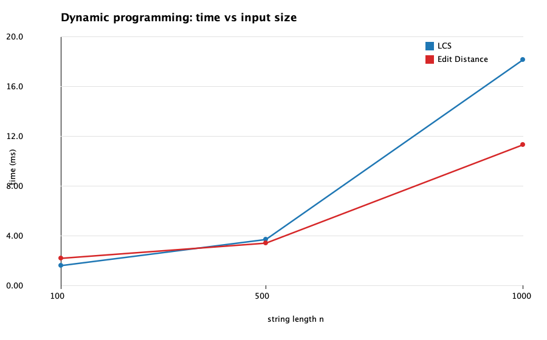
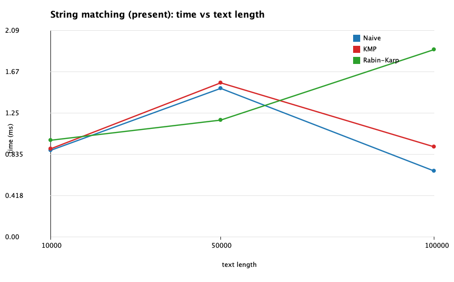
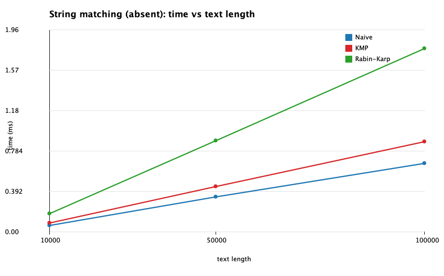
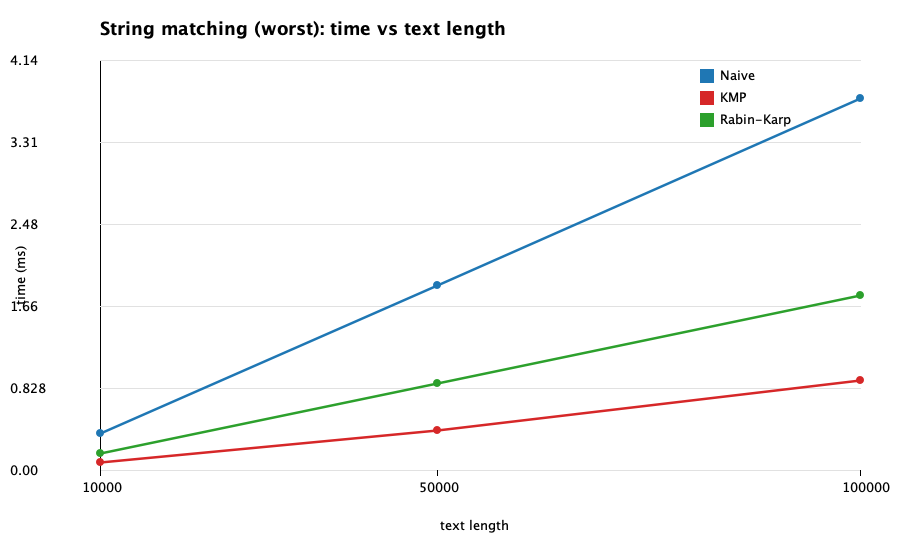
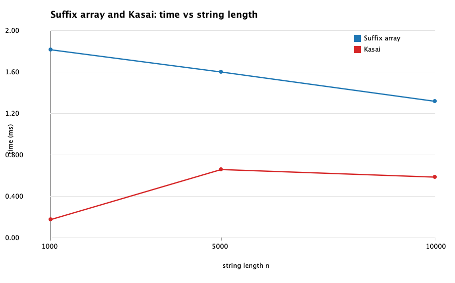

## LCS and Edit Distance

| n | LCS avg ms | Edit avg ms | LCS length | Edit distance | table cells |
|---|---|---|---|---|---|
| 100 | 1.6209 | 2.2257 | 67 | 56 | 10201 |
| 500 | 3.7519 | 3.4257 | 326 | 263 | 251001 |
| 1000 | 18.1840 | 11.3227 | 648 | 537 | 1002001 |

## String matching: present

| text length | algorithm | avg ms | char comparisons | occurrences |
|---|---|---|---|---|
| 10000 | Naive | 0.8795 | 13416 | 1 |
| 10000 | KMP | 0.8930 | 12529 | 1 |
| 10000 | Rabin-Karp | 0.9799 | 20 | 1 |
| 50000 | Naive | 1.5057 | 66677 | 1 |
| 50000 | KMP | 1.5628 | 61831 | 1 |
| 50000 | Rabin-Karp | 1.1836 | 20 | 1 |
| 100000 | Naive | 0.6680 | 132915 | 1 |
| 100000 | KMP | 0.9158 | 124696 | 1 |
| 100000 | Rabin-Karp | 1.8983 | 20 | 1 |

## String matching: absent

| text length | algorithm | avg ms | char comparisons | occurrences |
|---|---|---|---|---|
| 10000 | Naive | 0.0629 | 13426 | 0 |
| 10000 | KMP | 0.0890 | 12565 | 0 |
| 10000 | Rabin-Karp | 0.1774 | 0 | 0 |
| 50000 | Naive | 0.3400 | 66477 | 0 |
| 50000 | KMP | 0.4445 | 62431 | 0 |
| 50000 | Rabin-Karp | 0.8870 | 0 | 0 |
| 100000 | Naive | 0.6663 | 132721 | 0 |
| 100000 | KMP | 0.8770 | 124697 | 0 |
| 100000 | Rabin-Karp | 1.7816 | 0 | 0 |

## String matching: worst

| text length | algorithm | avg ms | char comparisons | occurrences |
|---|---|---|---|---|
| 10000 | Naive | 0.3745 | 199620 | 0 |
| 10000 | KMP | 0.0831 | 20018 | 0 |
| 10000 | Rabin-Karp | 0.1769 | 0 | 0 |
| 50000 | Naive | 1.8764 | 999620 | 0 |
| 50000 | KMP | 0.4133 | 100018 | 0 |
| 50000 | Rabin-Karp | 0.8864 | 0 | 0 |
| 100000 | Naive | 3.7631 | 1999620 | 0 |
| 100000 | KMP | 0.9183 | 200018 | 0 |
| 100000 | Rabin-Karp | 1.7744 | 0 | 0 |

## Suffix array (doubling) and Kasai LCP

| n | suffix array avg ms | Kasai avg ms |
|---|---|---|
| 1000 | 1.8179 | 0.1779 |
| 5000 | 1.6006 | 0.6599 |
| 10000 | 1.3202 | 0.5889 |

